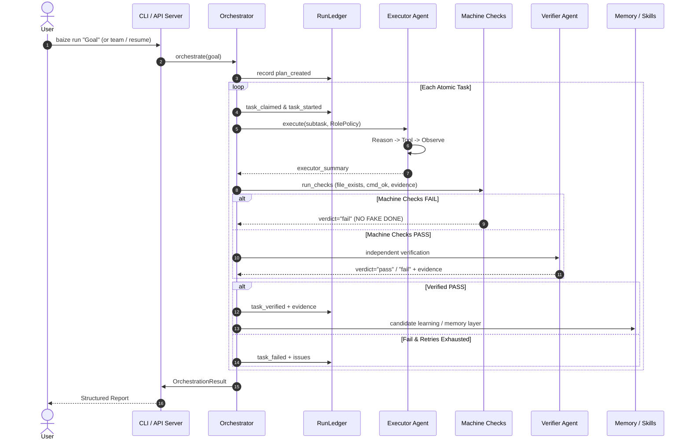

# Baize-Agent Architecture Overview

## 1. System Philosophy (Pi + Hermes + Unix)

Baize-Agent is an autonomous agent engineering runtime built on three pillars:
1. **Zero Runtime Dependencies**: 100% pure Python standard library (no PyYAML, no requests, no external vector DBs).
2. **Deterministic Governance & Verification (NO FAKE DONE)**: Progress is recorded in append-only JSONL ledgers with machine checks; claims without verified evidence are strictly rejected.
3. **Progressive Disclosure & Thin Layers**: Modular subpackages with progressive discovery and swappable components.

---

## 2. Modular Package Structure

```text
baize/                              # 0 flat modules + __main__.py, 8 domain subpackages (77 modules)
├── core/                           # 11 modules: agent loop, runtime_ctx (contextvars/file locks/atomic writes), context engine, cost ledger, plugin lifecycle, LLM client, config, sessions, autonomy
│   ├── agent.py  autonomy.py  component.py  config.py  context_engine.py  cost_ledger.py  llm.py  plugin.py  plugin_lifecycle.py  runtime_ctx.py  sessions.py
├── orchestration/                  # 8 modules: Director->Executor->Verifier DAG, spec hard-gate, contracts, hooks, ledger
│   ├── automations.py  contract.py  hooks.py  orchestrator.py  run_ledger.py  spec_workflow.py  system1.py  team.py
├── execution/                      # 13 modules: tools, bg_proc, worktree pool, stateful CDP E2E & visual verify, mobile bridge, Compose stack, cross-OS native sandbox, Git checkpoints, proc, PowerShell, Docker pool
│   ├── bg_proc.py  browser_verify.py  cdp_browser.py  checkpoint.py  compose_stack.py  docker_sandbox.py  mobile_bridge.py  powershell.py  proc.py  sandbox.py  tools.py  visual_verify.py  worktree.py
├── codebase/                       # 8 orthogonal static code intelligence, profile & diagnostics modules
│   ├── arch_cache.py               # incremental mtime/size-keyed SQLite architecture cache
│   ├── diagnostics.py              # zero-dependency stdio LSP client & compiler/linter diagnostic bridge
│   ├── impact.py                   # blast-radius analyzer, test-impact matrix & unified change-impact
│   ├── project_profile.py          # polyglot project fingerprint detection & automated build/test/lint gate
│   ├── recon.py                    # pre-flight prior-art & skill library reconnaissance
│   ├── repo_map.py                 # flat + L0/L1/L2 hierarchical repo maps & AST context slicer
│   ├── symbol_graph.py             # AST/regex symbol graph, PageRank, canonical SKIP_DIRS/SUPPORTED_EXTS
│   └── workspace_search.py         # zero-dependency workspace grep & glob search
├── knowledge/                      # 7 modules: layered + SQLite WAL + bounded memory, FTS5+Embedding hybrid index, graph, RAG/TF-IDF, skills & runner
│   ├── doc_crawler.py  graph.py  hybrid_index.py  memory.py  rag.py  skill_runner.py  skills.py
├── governance/                     # 9 modules: NO FAKE DONE gate, permissions engine, bench, eval harness, doctor, mutation, obs, dlp, telemetry
│   ├── bench.py  dlp.py  doctor.py  eval_harness.py  gate.py  mutation.py  observability.py  permissions.py  telemetry.py
├── interfaces/                     # 13 modules: CLI, REPL, Diff approval, JSONL RPC, HTTP/SSE server, jobs, ops, desktop, UI
│   ├── approval.py  cli.py  desktop.py  repl.py  rpc.py  serve.py  ui.py
│   └── server/                     # decomposed HTTP server subpackage
│       ├── jobs.py                 # SQLite WAL persistent async job queue & sliding-window rate limiter
│       ├── operations.py           # real outbound webhook, persistent RBAC, tool importer & CI autofix
│       ├── routes_get.py           # GET routes (/health, /api/jobs, /api/checkpoints, /api/channels, etc.)
│       ├── routes_post.py          # POST dispatch (/team/dag, /api/git/apply_hunk, /api/jobs, /api/channels/<ch>/webhook, etc.)
│       ├── security.py             # fail-closed auth, CORS allowlist, path guards
│       └── streaming.py            # real-time token + event SSE streaming for /run/stream
└── ext/                            # 8 modules: optional extensions (lazily loaded, fail-closed)
    ├── channels.py                 # bidirectional Feishu/DingTalk/Telegram/Slack webhook gateway
    ├── mcp/                        # unified Model Context Protocol client/server/dispatcher
    │   ├── client.py  component.py  dispatcher.py  server.py  transport.py
    ├── plugins/
    │   └── metrics.py              # feeds observability counters from lifecycle hooks
    └── providers/                  # native non-OpenAI provider adapters
        └── gemini.py               # pure-stdlib Google Gemini generateContent REST adapter
```

> This tree is generated from the filesystem by
> `scripts/gates/check_arch_tree.py`, which runs in the `hygiene` gate. An earlier
> revision of this section described a `core/ orchestration/ tooling/
> knowledge/ security/ server/` layout that did not exist: 39 of the 43 files it
> listed were really flat modules directly under `baize/`. The check exists so
> that cannot happen again.

---

## 3. Data Flow & Execution Lifecycle


